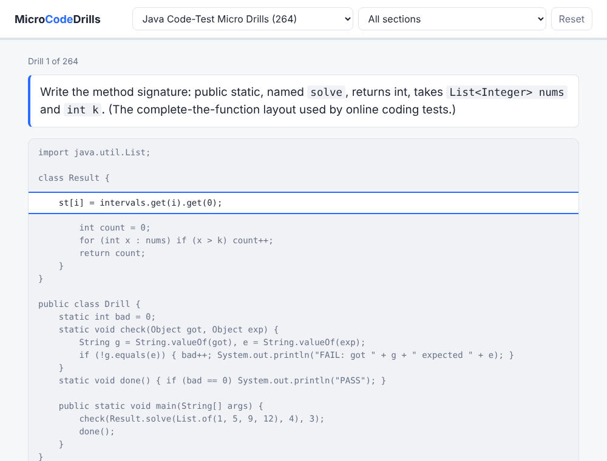

# MicroCodeDrills

Tiny, one-line coding drills you can blitz through in the browser. Each drill shows a complete, runnable
program with a single piece blanked out and a one-sentence prompt that names exactly what to write. Fill the
blank, press Submit, and your code is compiled and run against real checks. Right: next drill. Wrong: a pop-up
shows the expected code and a short explanation of why, then you move on.



The goal is muscle memory for the syntax that code tests lean on: input reading, collections, comparators,
streams, heaps, string and math helpers, plus the full import paths (no wildcards).

## Run it

Needs JDK 21 or newer. Nothing else to install.

```
git clone <this repo>
cd MicroCodeDrills
java Serve.java
```

Your browser opens at http://localhost:8765. Options: `--port 9000`, `--no-open`.
Python packs also need `python3` on your PATH, and the SQL pack needs it too.

## Packs

| Pack | Drills | Covers |
|---|---|---|
| `JavaCodeTestMicroDrills` | 264 | Input, collections, strings, sorting, queues and heaps, TreeMap, numbers, streams, algorithm skeletons, imports |
| `SqlCodeTestMicroDrills` | 15 | Joins, grouping, HAVING, window functions, CASE |
| `PythonCodeTestMicroDrills` | 6 | Starter pack that shows how another language plugs in |

Add your own: see [docs/AUTHORING.md](docs/AUTHORING.md).

## How it works

- Java 21 and the JDK's built-in HTTP server; no frameworks and no network calls at runtime.
- Your answer is spliced into the drill's template, compiled, and run in a separate process with a timeout.
  A program that prints `PASS` is correct.
- Where a prompt names a specific variant (for example `merge` versus `getOrDefault`), the drill requires that form.
- The server listens on localhost only and rejects foreign Host headers.
- Progress is saved in your browser.

## Check the packs

```
java Serve.java --verify
```

Runs every drill: the reference answer must pass and an empty blank must fail. CI runs this on every push.

## License

Copyright (c) 2026 John Blanton. All rights reserved. Source is public for viewing only; see [LICENSE](LICENSE).
